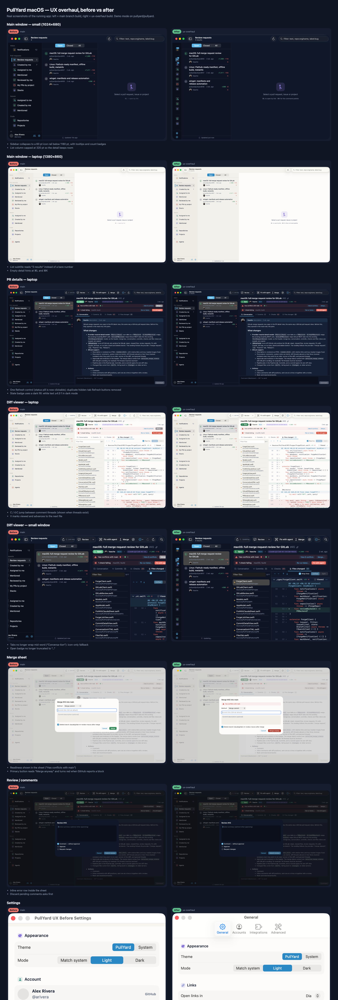
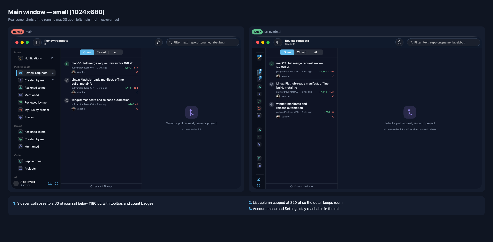
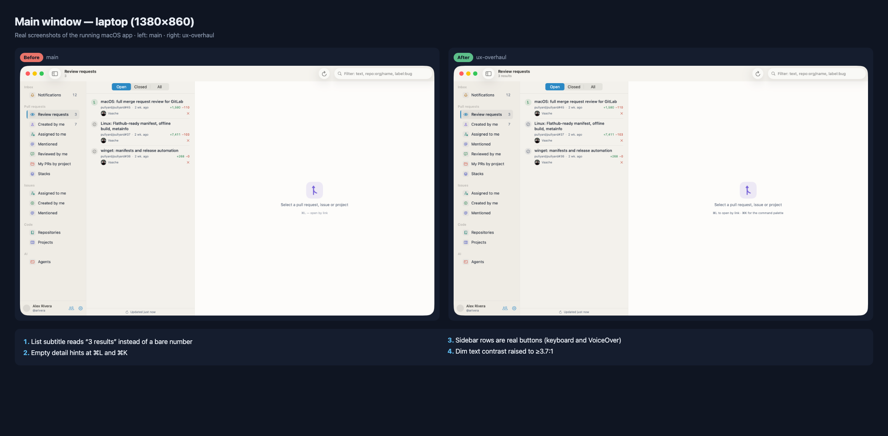
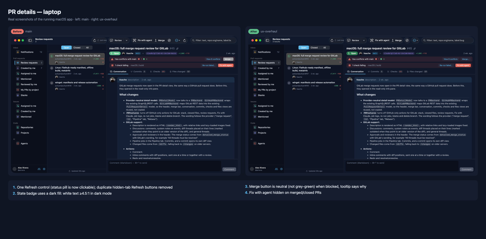
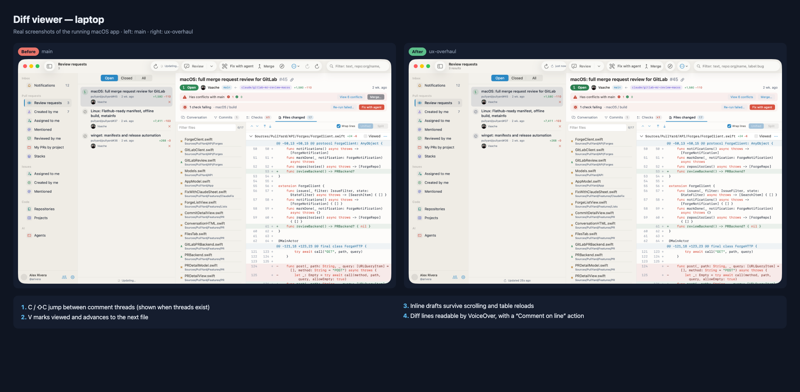
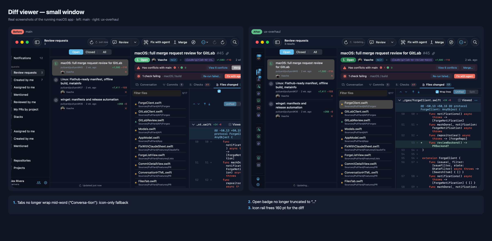
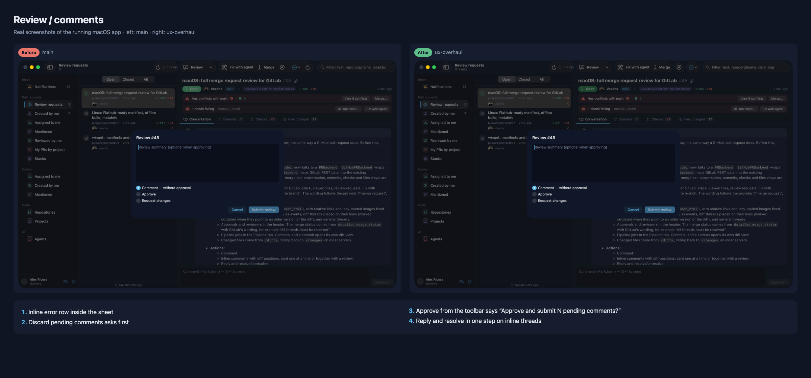
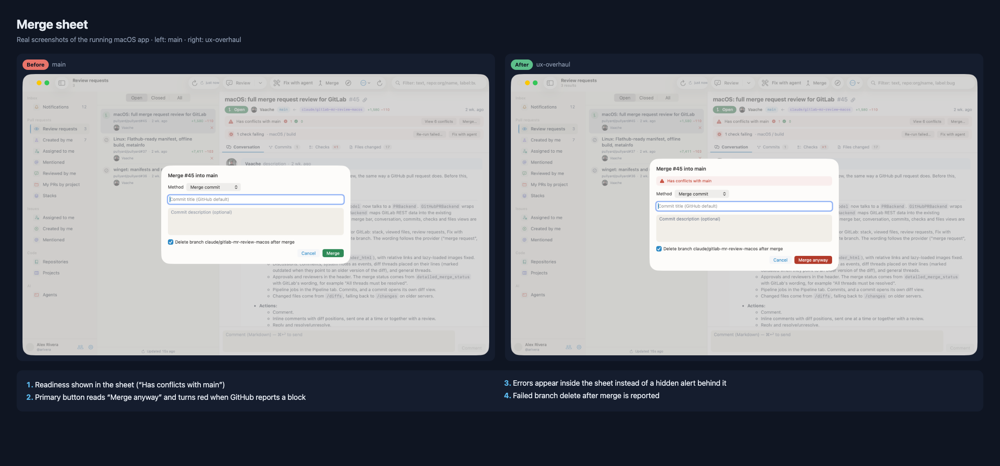
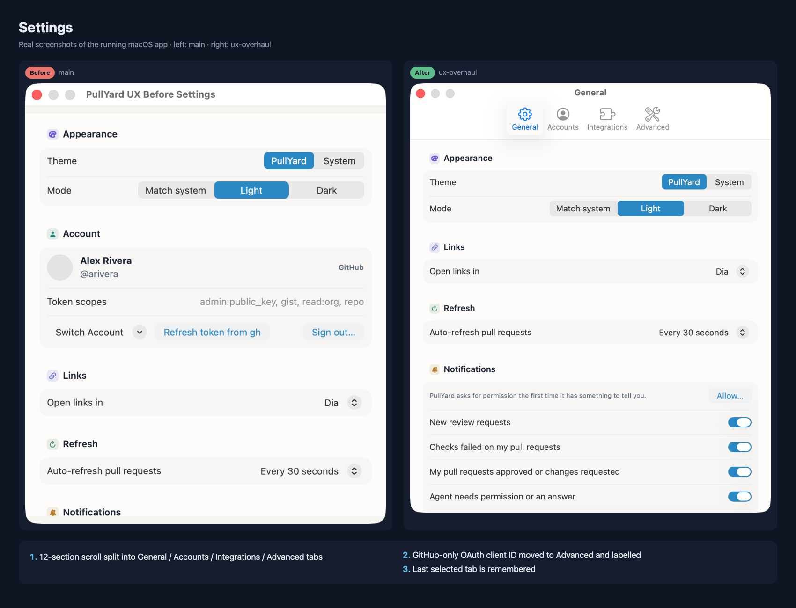
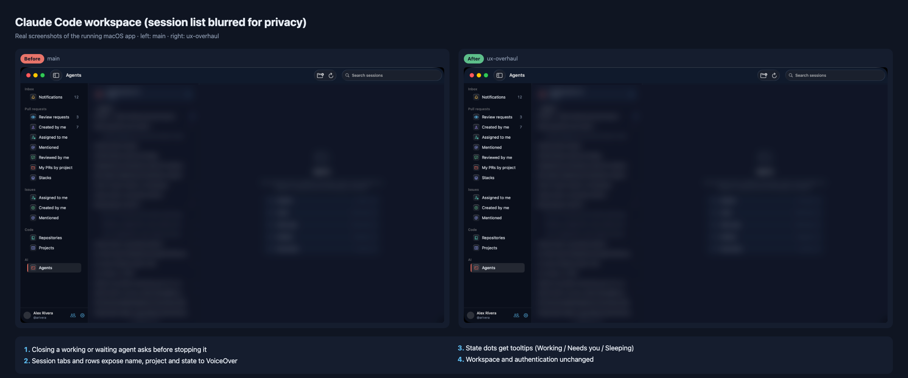

# PullYard UX Roadmap

Branch `ux-overhaul`, uncommitted. Related reports: [UX audit](PULLYARD_UX_AUDIT.md) · [Design system](PULLYARD_DESIGN_SYSTEM_AUDIT.md) · [Cross-platform](PULLYARD_CROSS_PLATFORM_REPORT.md).

## Completed in this branch

### macOS (built, tested and checked on the running app)
| Group | Change | Files |
|---|---|---|
| Tokens | `Space`, `Radius`, `Tint`, `Elevation`, `Font.syIcon`, `*Fill` / `syOnAccent` / `syHover` / `sySelected`; `syDim` contrast fix | `Shared/Theme.swift`, `Shared/Utilities.swift` |
| Shell | Icon rail below 1180 pt, list capped at 320 pt in compact mode, ⌃⌘S, Button-based sidebar rows, account footer without a loaded user, compact account menu | `App/RootView.swift`, `Auth/AccountSwitcher.swift` |
| Tabs | `ViewThatFits` icon fallback, `badgeLabel` | `Shared/TabStrip.swift` |
| Feedback | Error toasts (icon, 3 lines, 5 s, announced); inline sheet errors; load-more error row; notifications only change on success; job-log no-id message; revoked-token login notice; login double-submit guard | `AppModel.swift`, `ShortLink.swift`, `PRSheets.swift`, `SearchListView.swift`, `NotificationsView.swift`, `LoginView.swift` |
| PR workflow | Single real refresh control; duplicates removed; Fix with agent only on open PRs; solid state badge; Ready-for-review in the status bar; success toasts; approve-with-pending wording; merge readiness and "Merge anyway"; discard confirmation; reported branch-delete failure | `PRDetailView.swift`, `PRDetailModel.swift`, `PRSheets.swift` |
| Diff | Model-held drafts, discard confirmation; C/⇧C thread navigation; V advances; viewed rollback; VoiceOver labels and comment action; larger hit targets; Reply and resolve | `FilesTab.swift`, `DiffTableView.swift`, `PRDetailModel.swift` |
| Providers | Go menu provider labels, disabled unsupported sections, Projects hidden on forges; ⌘L disabled with an explanation on forge accounts; forge placeholder per section | `PullYardApp.swift`, `RootView.swift`, `ForgeListView.swift` |
| Agents | Confirm before closing a working or waiting agent; accessible tab rows and state glyphs | `ClaudeWorkspace.swift`, `ClaudeViews.swift`, `RootView.swift` |
| Settings | Tabbed Settings (General / Accounts / Integrations / Advanced), remembers the last tab, OAuth field relabelled | `App/SettingsView.swift` |

### Linux and Windows (static only, **not compiled or run**)
- Linux: approve-with-pending wording, discard confirmation, dim token.
- Windows: DPI-scaled initial size and minimum, centred in the work area; Ctrl+[ and mouse Back; approve-with-pending wording (+ regenerated `Resources.resw`); dim token.

## Decisions taken without the user (conservative choices)

1. **Compact breakpoint at 1180 pt, rail at 60 pt.** Below that width the sidebar becomes icons only. Hiding the sidebar entirely stays manual (⌃⌘S), so nothing disappears without the user asking.
2. **Merge readiness doesn't block merging.** Admins can still merge, so the button stays enabled and changes to a red "Merge anyway" only when GitHub reports a concrete block. UNKNOWN / "checking" stays neutral.
3. **Notifications read-on-select stays quiet on failure.** Explicit actions (Done, Mark all read, menu) show an error toast.
4. **Opening a second inline comment while a draft exists** keeps the draft and points the user to it, instead of discarding or swapping it silently.
5. **Windows type ramp (13 → 14 px) not changed in code.** It can't be checked visually here and could truncate fixed-width columns. It is shown in the mockups instead.
6. **Windows discard confirmation not ported.** WinUI allows only one `ContentDialog` at a time.
7. **No commits, no push.** Untracked user files (`pullyard_feat`, `pullyard_feat.md`, `PULLYARD_FEATURE_OPPORTUNITIES_RU.md`) were left untouched.
8. **Agents screenshots are blurred** (session titles and folder names are personal), including the raw files in `docs/ux-overhaul/screenshots/macos/*/agents-*.png`.

## Remaining work, by priority

### P0
- Diff: paginate `files(first:100)` so "viewed" survives on PRs with more than 100 files (`API/Queries.swift:95`, `PRDetailModel.swift:226`).
- Diff performance: invalidate only changed rows instead of `reloadData` + clearing all caches on every comment action or refresh (`PRDetailModel.swift:433`, `DiffTableView.swift:606`).
- Windows: compile and verify the DPI change on 100/150/200% displays; title bar redesign (48 px, back/pane/search inside, Mica visible).
- Accessibility: keyboard focus traversal for the Agents sidebar (`List(selection:)`), and a diff line cursor (j/k + Return to comment).

### P1
- Pending review stored on the server (`addPullRequestReview` without an event) or saved to disk.
- Word-level highlights for paired −/+ lines; "Expand context" on hunk headers; ignore-whitespace toggle.
- Review-thread paging past 100, or at least a "showing first 100" note.
- Forge accounts: map GitLab approvals and pipeline status and Gitea commit status into list badges; add capability flags so the UI can show "unknown" instead of "none"; make the Agents PR inspector provider-aware.
- Toolbar buttons with white text on coral/accent tints → `syAccentFill` (contrast 2.2–3.0:1 in dark mode).
- Windows: 14 px type ramp, cached section views, `ThemeResource` brushes (no rebuild on theme change), forward all app shortcuts from WebView2, Settings as a page, shortcut sheet, window state persistence.
- Linux: tray / background indicator, sidebar breakpoint and toggle, Ctrl+J, PR-tab shortcuts, comment navigation (C/⇧C), draft persistence, inline sheet errors.

### P2
- Shared `Pill`, `InlineBanner`, `FloatingCapsule`, `EmptyStateView`, `DisclosureHeader`, `CountBadge`; then a mechanical pass that applies the tokens everywhere.
- One source for palette, radius and spacing across the three platforms.
- List sort menu and per-section persisted state filter; hover Done on notifications.
- PR-tab shortcuts ⌥⌘1–9 instead of ⌃1–9 (Mission Control conflict); resizable sidebar.

## Deferred deliberately
- Claude Code authentication, session spawning and terminal: unchanged by design.
- Jira integration logic: unchanged (only moved to its own Settings tab).
- Provider API behaviour: no new provider capabilities were added. Unsupported actions stay hidden, not faked.

## Test app

- Path: `build/ux-overhaul/PullYard UX Test.app` (bundle id `dev.vaache.shipyard.uxtest`, executable `PullYarduxtest`, URL schemes removed, ad-hoc signed). The installed `/Applications/PullYard.app` was not touched.
- Rebuild: `docs/ux-overhaul/tools/make_test_app.sh "PullYard UX Test" uxtest`
- Relaunch (uses your `gh` token through `PULLYARD_TOKEN` and demo mode on `pullyard/pullyard`; nothing is written to the keychain): `docs/ux-overhaul/tools/launch_test_app.sh "PullYard UX Test"`
- Remove its settings: `defaults delete dev.vaache.shipyard.uxtest`
- Re-capture screenshots: `docs/ux-overhaul/tools/capture_set.sh "PullYard UX Test" uxtest docs/ux-overhaul/screenshots/macos/after dark` and `capture_sheets.sh` with the same arguments plus a mode. Comparison images: `docs/ux-overhaul/tools/render_comparison.sh`.

## Visual comparison

Real screenshots of the running macOS app. Left: `main` build (`PullYard UX Before`). Right: `ux-overhaul` build (`PullYard UX Test`).

### Overview

### Main window, small window (1024×680)

### Main window, laptop (1380×860)

### PR details

### Diff viewer

### Diff viewer, small window

### Review and comments

### Merge sheet

### Settings

### Claude Code workspace (session list blurred)

Raw screenshots (main at 3 sizes, PR detail, diff at 2 sizes, review and merge sheets, settings, agents; light and dark) are written to `docs/ux-overhaul/screenshots/macos/before/` and `.../after/` by the capture scripts. They are not committed, to keep the repository small; re-create them with the scripts above.
